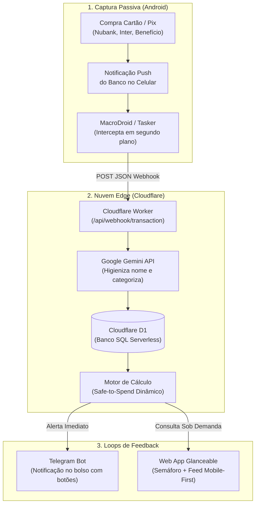

# Especificação Arquitetural e Funcional: Web App de Finanças Pessoais (Anti-TDAH)

## 1. Visão Geral e Princípios de Design

Este aplicativo foi concebido especificamente para uma usuária única com perfil **TDAH (Transtorno do Déficit de Atenção com Hiperatividade)**. O objetivo primordial é regular o comportamento de gastos em tempo real, eliminando os dois maiores motivos de abandono de ferramentas financeiras: **fadiga de decisão** e **fricção manual de registro**.



### Princípios Fundamentais
1. **Atrito Zero na Entrada:** Nenhuma necessidade de abrir o aplicativo após pagar um café ou almoço.
2. **Cegueira Temporal Resolvida:** O orçamento mensal é traduzido em uma métrica tangível: **"Quanto posso gastar hoje"**.
3. **Loop de Dopamina Invertido:** O feedback financeiro chega no mesmo segundo da compra via Telegram, conectando a ação ao saldo restante.
4. **Sem Culpa ou Punição:** Se você extrapolar hoje, o sistema não "quebra" o mês; ele reajusta suavemente a média dos dias seguintes.
5. **Autonomia por Padrão:** Classificação automática por IA sem exigir confirmação manual de cada item.

---

## 2. Arquitetura Técnica

| Camada | Tecnologia | Justificativa | Custo |
| :--- | :--- | :--- | :--- |
| **Captura** | Android (MacroDroid / Tasker) | Intercepta notificações de Nubank, Inter e Cartões Benefício (Flash, Swile, Caju) sem violar regras bancárias. | R$ 0 |
| **Backend & API** | Cloudflare Workers (TypeScript) | Serverless edge, latência ultrabaixa no Brasil, URL HTTPS nativa, zero manutenção de servidores. | R$ 0 |
| **Banco de Dados** | Cloudflare D1 (SQLite SQL) | Integrado ao Worker, consistente, rápido e com migrations simples via Wrangler. | R$ 0 |
| **Inteligência** | Google Gemini API (1.5 Flash) | Higienização de estabelecimentos obscuros e categorização autônoma em 3 grandes grupos. | R$ 0 (Tier gratuito) |
| **Alertas & Bot** | Telegram Bot API | Instantâneo, confiável, suporta botões interativos (inline keyboards) e comandos rápidos (`/hoje`). | R$ 0 |
| **Frontend** | Cloudflare Pages (React + Tailwind CSS / Vite) | Painel PWA de tela única, visual tipo Semáforo, focado em dispositivos móveis. | R$ 0 |
| **Autenticação** | PIN Numérico (LocalStorage) | Proteção simples e persistente, sem necessidade de logins repetitivos. | R$ 0 |

---

## 3. Modelo Matemático: "Livre do Dia" com Ajuste Dinâmico

O cálculo elimina planilhas complexas com a fórmula:

$$\text{Orçamento Flexível do Mês} = \text{Renda Líquida} - \text{Custos Fixos} - \text{Meta de Reserva}$$

$$\text{Disponível para Hoje} = \frac{\text{Orçamento Flexível Restante no Mês}}{\text{Dias Restantes do Mês}}$$

### Lógica do Semáforo:
* 🟢 **Verde (Normal):** Gastos do dia $\le \text{Disponível para Hoje}$.
* 🟡 **Amarelo (Atenção):** Gastos do dia entre $100\%$ e $130\%$ da meta diária.
* 🔴 **Vermelho (Excedido):** Gastos ultrapassaram $130\%$ da meta do dia (o excedente é distribuído suavemente reduzindo os dias restantes).

---

## 4. O Mecanismo Anti-TDAH em Detalhes

### A. Categorização em 3 Baldes (Sem Micromanagement)
1. **Fixos Obrigatórios:** Aluguel, contas de consumo, assinaturas, remédios contínuos.
2. **Dia a Dia / Rotina:** Mercado, refeições rotineiras, transporte de trabalho.
3. **Impulso / Supérfluo:** Delivery (iFood, Zé Delivery), compras online (Shopee, Amazon), passeios não planejados.

### B. Notificações Proativas no Telegram
Ao receber um gasto, o bot responde em menos de 3 segundos:

> 💸 **R$ 38,50** no **iFood** *(Classificado como: Impulso)*  
> 🟢 **R$ 71,50** livres para hoje  
> 📊 **Termômetro de Impulso:** R$ 320 / R$ 500 do mês  
> `[ Mudar para Rotina ]` `[ Ver Semáforo ]`

Comandos do Bot:
* `/hoje`: Retorna o saldo disponível do dia atual.
* `/gastei 25 Padaria`: Registro manual ultra-rápido caso compre algo em dinheiro.
* `/resumo`: Status da semana e projeção do mês.

---

## 5. Estrutura do Banco de Dados (Cloudflare D1)

```sql
-- Configurações da usuária e metas
CREATE TABLE user_settings (
    id INTEGER PRIMARY KEY DEFAULT 1,
    pin_hash TEXT NOT NULL,
    monthly_income REAL DEFAULT 0,
    savings_goal REAL DEFAULT 0,
    impulse_monthly_limit REAL DEFAULT 0,
    telegram_chat_id TEXT
);

-- Gastos fixos cadastrados (recorrentes)
CREATE TABLE fixed_expenses (
    id INTEGER PRIMARY KEY AUTOINCREMENT,
    name TEXT NOT NULL,
    amount REAL NOT NULL,
    due_day INTEGER NOT NULL,
    is_active BOOLEAN DEFAULT 1
);

-- Transações capturadas e processadas
CREATE TABLE transactions (
    id INTEGER PRIMARY KEY AUTOINCREMENT,
    source TEXT NOT NULL, -- 'NUBANK', 'INTER', 'BENEFICIO', 'MANUAL'
    raw_text TEXT,
    merchant TEXT NOT NULL,
    amount REAL NOT NULL,
    category TEXT NOT NULL, -- 'FIXED', 'DAILY', 'IMPULSE'
    is_impulse BOOLEAN DEFAULT 0,
    created_at TIMESTAMP DEFAULT CURRENT_TIMESTAMP
);
```

---

## 6. Telas do Web App (Glanceable UI)

A interface é construída em tela única:
1. **Header com Semáforo:** Cor de fundo adaptativa (verde suave, amarelo ou vermelho discreto), mostrando em fonte grande: **"R$ 85,00 livres hoje"**.
2. **Barra de Termômetro de Impulsos:** Mostra o progresso do teto de compras supérfluas do mês para evitar surpresas no fim do mês.
3. **Feed de Últimos Gastos:** Cards modernos com o ícone do banco (roxo Nubank, laranja Inter), valor, categoria com badge clicável para reclassificação instantânea.
4. **Gaveta Deslizante (Configurações):** Onde a usuária altera a renda, cadastra novos custos fixos ou atualiza a meta de economia.
